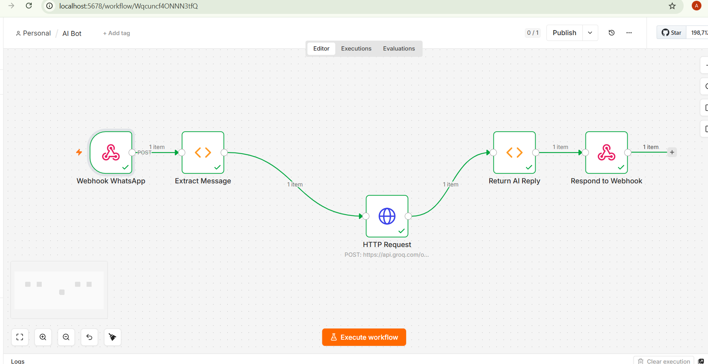
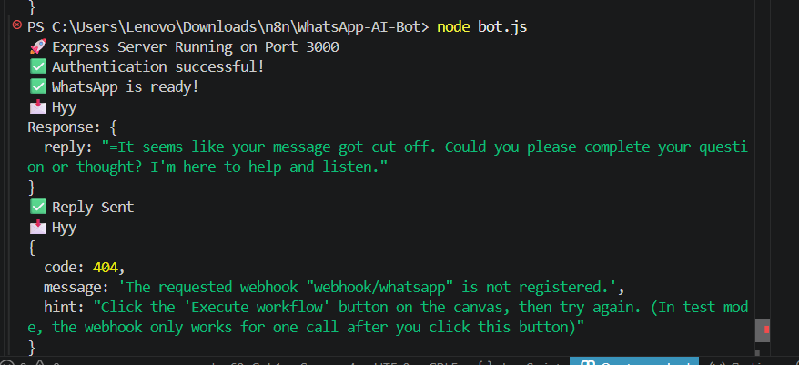
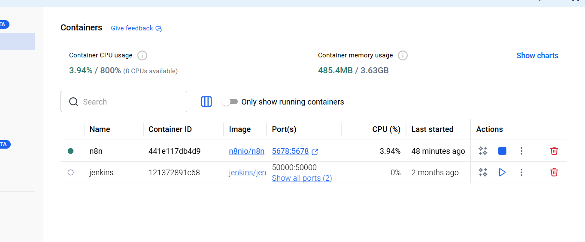
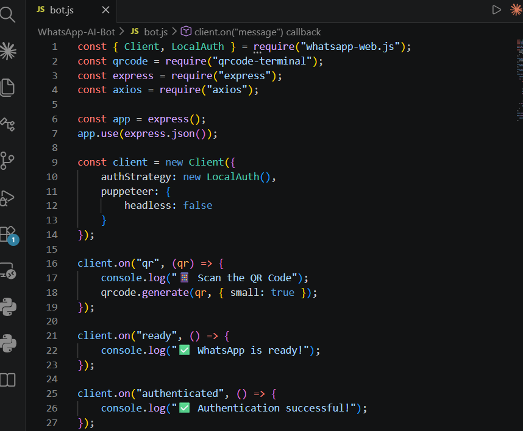
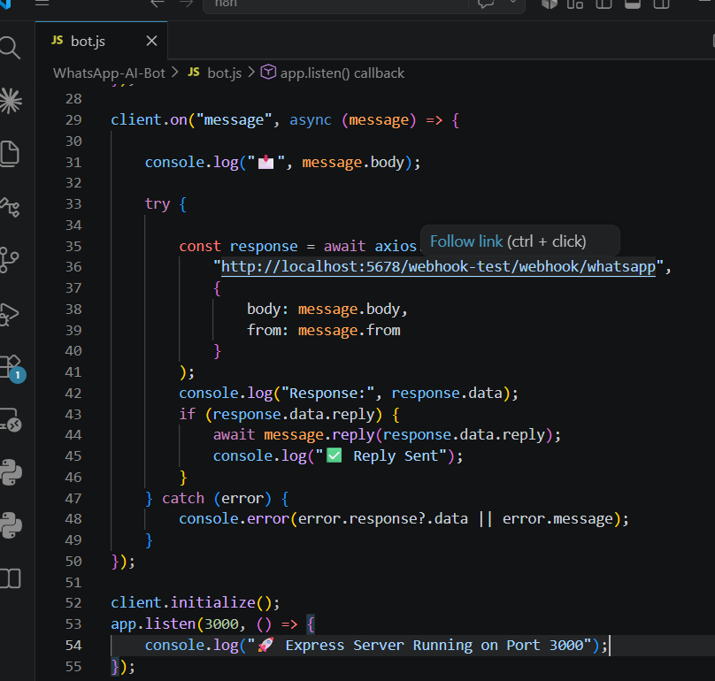

# 🤖 WhatsApp AI Bot using n8n + Groq + Node.js

A WhatsApp AI chatbot built using **Node.js**, **whatsapp-web.js**, **n8n**, and the **Groq API**. The bot receives messages on WhatsApp, forwards them to an n8n workflow, generates an AI response using Groq's Llama model, and automatically replies back to the user.

---

## 🚀 Features

- 📱 WhatsApp Web Integration
- 🔄 n8n Workflow Automation
- 🤖 AI-powered responses using Groq Llama 3.3
- ⚡ Fast response generation
- 🌐 REST API communication between Node.js and n8n
- 🔐 Local WhatsApp authentication using LocalAuth

---

# 🛠 Tech Stack

- Node.js
- Express.js
- whatsapp-web.js
- Axios
- n8n
- Groq API
- QRCode Terminal

---

# 📂 Project Structure

```
WhatsApp-AI-Bot/
│
├── bot.js                 # Main WhatsApp bot
├── package.json
├── package-lock.json
├── .wwebjs_auth/          # WhatsApp session (generated automatically)
└── README.md
```

---

# ⚙️ Workflow Architecture

```
WhatsApp
      │
      ▼
Node.js (whatsapp-web.js)
      │
      ▼
POST Request
      │
      ▼
n8n Webhook
      │
      ▼
Extract Message
      │
      ▼
HTTP Request
      │
      ▼
Groq API (Llama 3.3)
      │
      ▼
Return AI Reply
      │
      ▼
Respond to Webhook
      │
      ▼
Node.js
      │
      ▼
WhatsApp Reply
```

---

# 📦 Installation

Clone the repository

```bash
git clone https://github.com/<your-username>/WhatsApp-AI-Bot.git
```

Go inside the project

```bash
cd WhatsApp-AI-Bot
```

Install dependencies

```bash
npm install
```

---

# 📚 Required Packages

```bash
npm install whatsapp-web.js express axios qrcode-terminal
```

---

# 🔑 API Setup

Create a Groq API Key

https://console.groq.com/keys

Copy your API key.

In the n8n HTTP Request node, configure:

**URL**

```
https://api.groq.com/openai/v1/chat/completions
```

Headers

```
Authorization: Bearer YOUR_GROQ_API_KEY
Content-Type: application/json
```

Model

```
llama-3.3-70b-versatile
```

---

## Import Workflow

Import `workflow.json` into n8n to recreate the complete workflow.

```
Workflow → Import → Select workflow.json
```

---

# ▶ Running the Bot

Start n8n

```bash
docker start n8n
```

Open n8n

```
http://localhost:5678
```

Execute the workflow.

Start the bot

```bash
node bot.js
```

Scan the QR code if required.

Send a WhatsApp message to the connected account.

The bot will automatically reply using AI.

---

# 🧠 n8n Workflow

The workflow contains five nodes:

1. Webhook WhatsApp
2. Extract Message
3. HTTP Request (Groq API)
4. Return AI Reply
5. Respond to Webhook

---

# 🔄 HTTP Request Body

```json
{
  "model": "llama-3.3-70b-versatile",
  "messages": [
    {
      "role": "system",
      "content": "You are a helpful AI companion."
    },
    {
      "role": "user",
      "content": "={{ $json.message.body }}"
    }
  ]
}
```

---

# 📸 Demo

User sends

```
Hello
```

↓

Groq generates

```
Hello! How can I help you today?
```

↓

Bot replies automatically on WhatsApp.

---


Developed as a workflow automation and AI integration project using:

- Node.js
- n8n
- Groq API
- WhatsApp Web

---

# 📸 Project Screenshots

## Workflow in n8n

Shows the complete workflow from receiving a WhatsApp message to generating an AI response using Groq.

<p align="center">

</p>

---

## Successful Bot Execution

Node.js receives a WhatsApp message, sends it to n8n, receives the AI response from Groq, and replies back automatically.

<p align="center">

</p>

---

## Docker Container

n8n is running inside Docker.

<p align="center">

</p>

---

## Main Bot Code

Initialization of the WhatsApp client, QR authentication, Express server, and LocalAuth.

<p align="center">

</p>

---

## Message Processing Logic

Receives WhatsApp messages, forwards them to n8n through Axios, and replies with the generated AI response.

<p align="center">

</p>

---
